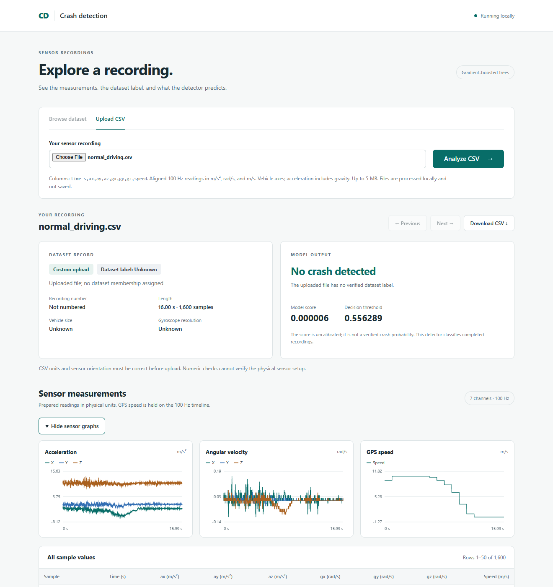
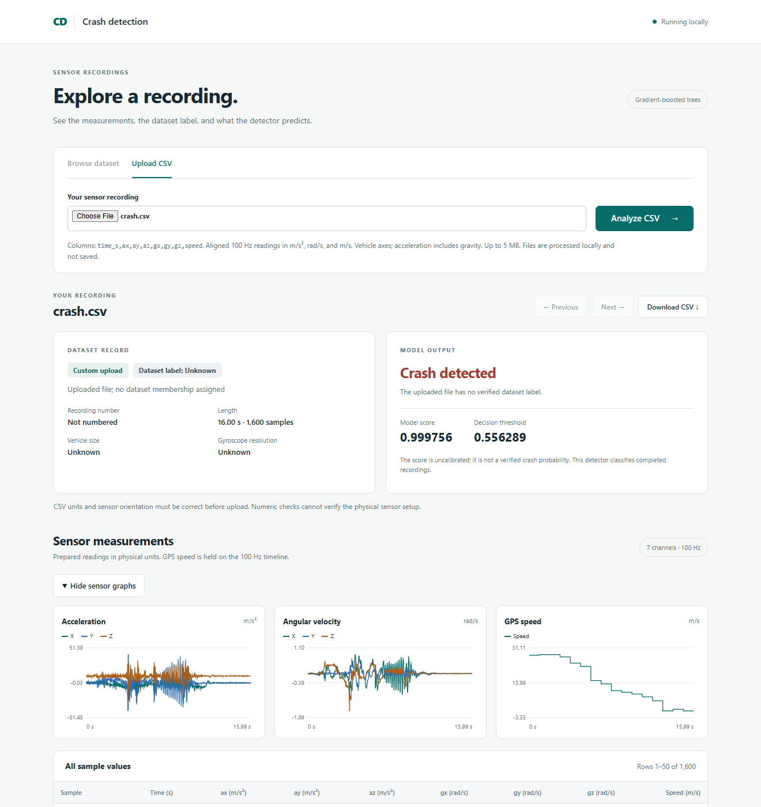
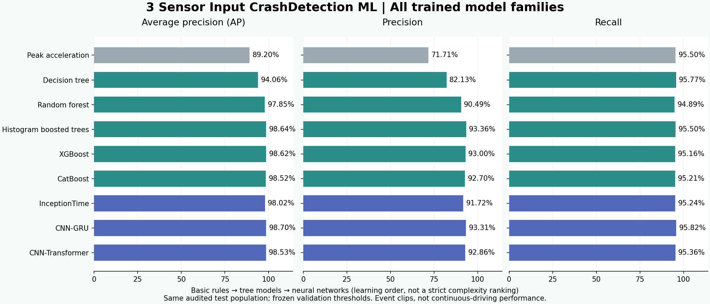

# 3 Sensor Input CrashDetection ML

**Learn how to detect crash events using three sensor inputs: accelerometer, gyroscope, and GPS speed.** This project takes a complete sensor recording and predicts whether the clip contains a crash. It walks from a simple acceleration rule through decision trees and boosting to neural networks.

You can try the included CSV files immediately using a pretrained model. **No dataset download, model training, or GPU is needed for the demo.**

[Try a prediction](#1-download-the-project) · [CSV screenshots](#4-see-real-csv-predictions) · [All model results](#6-compare-all-the-models) · [Train the models](docs/training.md)

## What are the three inputs?

| Sensor | What it measures | CSV columns | Units |
|---|---|---|---|
| Accelerometer | Movement and impact along three axes, including gravity | `ax, ay, az` | m/s² |
| Gyroscope | Rotation around three axes | `gx, gy, gz` | radians/s |
| GPS speed | How fast the vehicle is moving | `speed` | m/s |

Three sensor types produce **seven numeric channels**. `time_s` is the timestamp, not an eighth sensor. All channels share a 100 Hz timeline: one row every 0.01 seconds. Vehicle axes are X forward, Y left, and Z up.

```text
Sensor CSV → check columns, units and timing → trained model → score → threshold → prediction
```

Tree models summarize each recording into 203 features. Neural models learn temporal patterns directly from the seven-channel sequence. This is a completed-clip research classifier; it does not trigger emergency services or control a vehicle.

## 1. Download the project

Install Python **3.11 or newer** and Git, then open a terminal:

```bash
git clone https://github.com/adiltemp908-cyber/3-Sensor-Input-CrashDetection-ML.git
cd 3-Sensor-Input-CrashDetection-ML
```

Alternatively, choose **Code → Download ZIP** on GitHub, extract it, and open a terminal inside the extracted folder. You should see `README.md`, `examples`, and `models`.

## 2. Create an environment and install

A virtual environment keeps this project's Python packages together.

**Windows PowerShell:**

```powershell
python -m venv .venv
.\.venv\Scripts\Activate.ps1
python -m pip install --upgrade pip
python -m pip install -e .
```

**macOS / Linux:**

```bash
python3 -m venv .venv
source .venv/bin/activate
python -m pip install --upgrade pip
python -m pip install -e .
```

The install downloads NumPy, scikit-learn and PyTorch, so the first setup can take a few minutes. The included histogram model uses scikit-learn 1.6.1, pinned for saved-model compatibility. Historical experiment versions are recorded under [`requirements/`](requirements/).

**Expected result:** installation completes without an error. If PowerShell blocks activation, use `.\.venv\Scripts\python.exe` instead of `python` in the remaining commands; changing your execution policy is unnecessary.

## 3. Run your first prediction

From the project folder:

```bash
python scripts/predict_custom_csv.py --input examples/normal_driving.csv
```

**Expected output with the included histogram gradient-boosting model:**

```text
Read 1600 samples and 7 sensor channels.
{
  "score": 5.87067069947733e-06,
  "threshold": 0.5562889424776457,
  "crash_clip": false,
  "model": "trees",
  "deployment_validated": false,
  "task": "event-clip classification"
}
```

The model returns `crash_clip: true` when its score is at least the threshold. Here, the score is very small, so it predicts **no crash**. A score is an uncalibrated model output, not a verified real-world crash probability. Tiny numeric differences can occur across environments.

Now try a crash recording and an artificial input:

```bash
python scripts/predict_custom_csv.py --input examples/crash.csv
python scripts/predict_custom_csv.py --input examples/synthetic_pulse.csv
```

| CSV | Where it came from | Reference label | Model score | Prediction |
|---|---|---|---:|---|
| `normal_driving.csv` | VZCrash test event 19088 | Normal driving | 0.000006 | No crash |
| `crash.csv` | VZCrash test event 2492132 | Crash | 0.999756 | Crash |
| `synthetic_pulse.csv` | Artificial pulse for learning the workflow | Unknown | 0.977109 | Crash |

These are examples, not a three-record accuracy test. The synthetic file is **not real crash evidence** and was not part of training or evaluation. Full numeric outputs for both bundled models are saved in [`examples/predictions.json`](examples/predictions.json).

## 4. See real CSV predictions

Prefer clicking to typing? Start the local recording browser:

```bash
python -m crashdetect.vzcrash.browser
```

The terminal prints a local address, normally `http://127.0.0.1:8877`, and opens your browser. Keep the terminal running. Choose **Upload CSV**, select an example from `examples/`, and click **Analyze CSV**. Expand **Show sensor graphs** to inspect acceleration, rotation, and speed. Press **Ctrl+C** in the terminal when finished.

**Normal-driving CSV:** the saved model predicts no crash.



**Crash CSV:** the saved model predicts a crash.



These screenshots were captured by uploading the included files and running the bundled model. The interface correctly displays **Dataset label: Unknown** for uploads: a filename does not prove ground truth. The reference labels above come from the separately documented VZCrash source events. See [example provenance and attribution](examples/README.md).

## 5. Try the validation-selected XGBoost model

The simple demo uses histogram gradient boosting. A second included checkpoint lets you try **XGBoost**, the winner under the experiment's validation selection rule:

```bash
python -m pip install "xgboost==3.0.5"
python scripts/predict_custom_csv.py --model models/xgboost --input examples/crash.csv
```

**Expected result:** model `xgboost`, score approximately `0.999911`, threshold `0.547762`, and `crash_clip: true`. CPU inference works even though this checkpoint was trained using a GPU.

## 6. Compare all the models

All **eight trained families**, plus the untrained physical baseline, are shown below. The order is a learning path from simple rules through tree ensembles to sequence networks, not a strict computational-complexity ranking. More elaborate models do not automatically perform better.

### First, understand the numbers

- **Recall:** of the actual crash recordings, how many did the model catch?
- **Precision:** of the recordings flagged as crashes, how many were actually crashes?
- **Average precision (AP):** summarizes the precision–recall tradeoff across score thresholds. It is **not accuracy**.
- **Misses:** crash recordings the model failed to flag.
- **False positives:** non-crash recordings the model flagged as crashes.

### Basic models → boosted trees → neural networks

| Stage | Model | How it works | Test AP | Test recall | Test precision | Misses | False positives |
|---|---|---|---:|---:|---:|---:|---:|
| Baseline | Peak acceleration | A threshold on the strongest horizontal acceleration | 89.20% | 95.50% | 71.71% | 184 | 1,542 |
| Basic ML | Decision tree | A sequence of learned if/else rules | 94.06% | 95.77% | 82.13% | 173 | 853 |
| Ensemble ML | Random forest | Combines many decision trees | 97.85% | 94.89% | 90.49% | 209 | 408 |
| Boosting | Histogram gradient boosting | Adds trees to correct previous mistakes | 98.64% | 95.50% | **93.36%** | 184 | **278** |
| Boosting | XGBoost | Regularized gradient-boosted trees | 98.62% | 95.16% | 93.00% | 198 | 293 |
| Boosting | CatBoost | Gradient boosting with symmetric trees in this experiment | 98.52% | 95.21% | 92.70% | 196 | 307 |
| Deep learning | InceptionTime, single network | Convolutions at multiple time scales | 98.02% | 95.24% | 91.72% | 195 | 352 |
| Deep learning | CNN–GRU | Convolutional features plus recurrent sequence memory | **98.70%** | **95.82%** | 93.31% | **171** | 281 |
| Deep learning | CNN–Transformer | Convolutional features plus attention over time | 98.53% | 95.36% | 92.86% | 190 | 300 |



**Which model won?** XGBoost was selected using **validation precision while meeting at least 95% validation recall**, with validation AP as the tiebreaker. It achieved 93.65% validation precision. The test set did not choose the winner. CNN–GRU has the highest observed test AP and recall; histogram gradient boosting has the highest observed test precision. These small differences do not prove one model is universally best. Random forest's test recall fell slightly below the 95% target.

**What data were used?** Every trained family used 137,357 usable training recordings. Validation contains 27,032 recordings. The retained test population contains 24,042 events, including 4,093 crashes and one non-crash with unusable sensors; AP and false-positive rate use the 24,041 usable inputs. All members of exact-input duplicate groups were excluded before training. Near misses count as non-crashes.

The same test population was examined across successive experiments, so this is an **exploratory comparison**, not a fresh independent evaluation. Continuous-driving false alarms per hour and crash-to-alert delay remain unmeasured.

For validation scores, thresholds, confusion counts, cohort results and learning histories, see the [full results guide](results/README.md), [machine-readable results](results/comparison.json), and [data audit](docs/data-audit.md).

## 7. Use your own CSV

Your first line must be exactly:

```csv
time_s,ax,ay,az,gx,gy,gz,speed
```

Each later line must contain finite numeric values. Timestamps increase by 0.01 seconds; speed must be nonnegative. Use the units and axes listed above. A typical 16-second recording has 1,600 rows plus the header. The parser accepts 32–20,000 samples; this is a software bound, not evidence of accuracy at every clip length.

```bash
python scripts/predict_custom_csv.py --input path/to/your_recording.csv
```

Do not fill missing sensors with invented zeros, use km/h as m/s, or upload unaligned phone axes. The parser can detect malformed numbers and timing, but cannot verify a physical installation. See [the input and browser guide](docs/usage.md) for conversion details and troubleshooting.

## 8. Train the models yourself

Follow the [step-by-step training guide](docs/training.md) to obtain the dataset through its provider, prepare the audited splits, train models in learning order, compare results, and run your own checkpoints. The full dataset is approximately 7.74 GB to download; budget around 20 GB or more for data and generated outputs.

The two inference bundles here are enough for the demo. Other model weights, training recordings and generated artifacts are deliberately omitted; their measured results and training code are included.

## Find your way around

```text
README.md       Start here: setup, predictions, screenshots, all model results
crashdetect/    Three-sensor preparation, training, inference and browser code
examples/       Two real CSV excerpts, one synthetic input, expected predictions
models/         Two compact pretrained inference bundles
results/        Complete measured comparison for all trained families
docs/           Usage, training, data audit and README images
scripts/        CSV prediction and comparison commands
tests/          Data, model, threshold and browser checks
requirements/   Recorded dependency versions
```

The old four-sensor experiment, full datasets, virtual environments, caches, logs, temporary files and generated PDF reports are not part of this repository.

## Dataset credit and research limits

Real examples and training data come from [VZCrash](https://huggingface.co/datasets/vzc-research-chapter/VZCrash), by Bianconcini, Monteagudo, Pjetri, Trinci and Taccari (2026), released under [CC BY-NC 4.0](https://creativecommons.org/licenses/by-nc/4.0/). The CSV excerpts convert provider values into SI units; GPS speed is held on the IMU timeline. See [NOTICE.md](NOTICE.md) for attribution and scope.

The collection is based on selected commercial-vehicle events. Results do not establish performance for continuous driving, other sensor installations, passenger cars generally, or smartphones. Vehicle-level independence could not be independently verified from released metadata. Scores are uncalibrated. Use this project for learning and noncommercial research, not as a validated safety or emergency-response system.
