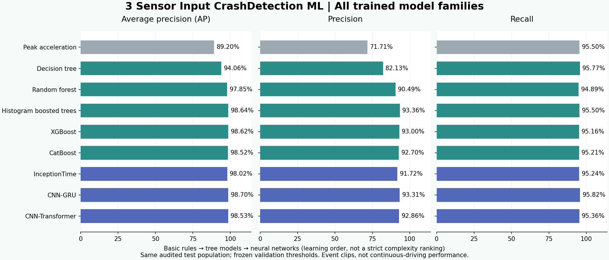
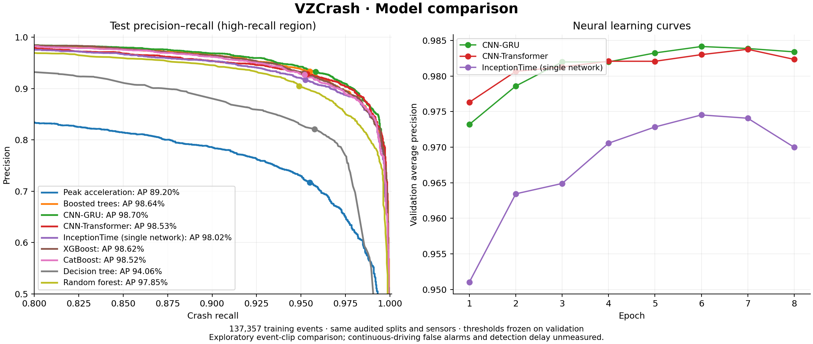

# All measured model results

Eight learned model families and one physical baseline, ordered from basic rules to tree ensembles and sequence networks. These are the completed October 2026 runs, not new training performed for repository publication. Source metrics and histories are preserved in [comparison.json](comparison.json); local absolute run paths were made relative.

## Validation selection

**Selected: XGBoost.** The rule first requires at least 95% validation recall, then maximizes validation precision, with validation AP as tiebreaker. No test metric participates in this selection.

| Model | Validation AP | Validation recall | Validation precision | Frozen threshold |
|---|---:|---:|---:|---:|
| Peak acceleration | 87.96% | 95.02% | 70.42% | 1.56456387 |
| Decision tree | 94.21% | 95.29% | 81.18% | 0.190812721 |
| Random forest | 97.73% | 95.04% | 90.53% | 0.473333333 |
| Histogram gradient boosting | 98.42% | 95.02% | 93.43% | 0.556288942 |
| XGBoost | 98.47% | 95.02% | 93.65% | 0.547762215 |
| CatBoost | 98.38% | 95.02% | 93.01% | 0.536443818 |
| InceptionTime (single network) | 97.45% | 95.07% | 91.92% | 0.301086366 |
| CNN–GRU | 98.42% | 95.02% | 93.10% | 0.247059569 |
| CNN–Transformer | 98.38% | 95.17% | 92.95% | 0.613132238 |

## Test results

| Model | AP | ROC AUC | Recall | Precision | False-positive rate | TP | FN | FP | TN |
|---|---:|---:|---:|---:|---:|---:|---:|---:|---:|
| Peak acceleration | 89.20% | 97.91% | 95.50% | 71.71% | 7.73% | 3,909 | 184 | 1,542 | 18,406 |
| Decision tree | 94.06% | 98.46% | 95.77% | 82.13% | 4.28% | 3,920 | 173 | 853 | 19,095 |
| Random forest | 97.85% | 99.53% | 94.89% | 90.49% | 2.05% | 3,884 | 209 | 408 | 19,540 |
| Histogram gradient boosting | 98.64% | 99.71% | 95.50% | 93.36% | 1.39% | 3,909 | 184 | 278 | 19,670 |
| XGBoost | 98.62% | 99.71% | 95.16% | 93.00% | 1.47% | 3,895 | 198 | 293 | 19,655 |
| CatBoost | 98.52% | 99.69% | 95.21% | 92.70% | 1.54% | 3,897 | 196 | 307 | 19,641 |
| InceptionTime (single network) | 98.02% | 99.59% | 95.24% | 91.72% | 1.76% | 3,898 | 195 | 352 | 19,596 |
| CNN–GRU | 98.70% | 99.73% | 95.82% | 93.31% | 1.41% | 3,922 | 171 | 281 | 19,667 |
| CNN–Transformer | 98.53% | 99.69% | 95.36% | 92.86% | 1.50% | 3,903 | 190 | 300 | 19,648 |

TP = detected crashes; FN = missed crashes; FP = flagged non-crashes; TN = usable non-crashes correctly rejected.

The retained population has 24,042 test events: 4,093 crashes and 19,949 non-crashes. One negative event has unavailable sensors. Consequently TP + FN + FP + TN is 24,041, not 24,042. AP/AUC are conditional on usable inputs; false-positive rate uses usable negatives. Eligible unavailable crashes would count as misses. Near misses are binary negatives.

## Precision–recall and neural learning curves

The left panel compares test ranking behavior; markers show the thresholds frozen on validation. The right panel records validation AP over the neural training epochs.

## Training record

All learned families used 137,357 usable real training recordings, all seven sensor channels, the same normalization fit on training only, the same audited splits, and seed 42. The physical baseline fits no model parameters. Tree families use 203 derived features. Neural models use masked variable-length sensor sequences.

| Neural model | Epochs completed | Selected epoch | Recorded epoch wall time |
|---|---:|---:|---:|
| InceptionTime (single network) | 8 | 6 | 63.3 min |
| CNN–GRU | 8 | 6 | 52.3 min |
| CNN–Transformer | 8 | 7 | 628.2 min |

Wall times include pauses and are not controlled speed benchmarks. CNN–GRU and CNN–Transformer ran on CPU; InceptionTime used the RTX 4050 with mixed precision and batch size 16. Boosted XGBoost/CatBoost training used the GPU, with CPU inference. Training arguments and direct library versions are preserved in [run-settings.json](run-settings.json).

## Reading the comparison

- The simple peak rule catches many crashes but produces 1,542 false positives. Histogram boosting reduces this to 278 at similar recall.
- Random forest improves on a single decision tree in AP and precision, but its 94.89% test recall misses the 95% target.
- XGBoost wins the predefined validation rule. CNN–GRU has the highest observed test AP and recall; histogram boosting has the highest observed test precision.
- The small differences among leading models do not establish statistical superiority. More complex networks did not consistently outperform feature-based boosting.

## What remains unmeasured

Continuous-driving false alarms/hour and impact-to-alert delay are null, not zero. The test population was examined during earlier experiments; these follow-up comparisons are exploratory. Vehicle identifiers are unavailable, so vehicle-level independence and vehicle-cluster confidence intervals cannot be verified. Exact-input deduplication does not remove all possible approximate duplicates. Scores are not calibrated deployment probabilities. Vehicle-size and gyro-resolution cohort metrics and event-binomial intervals are in `comparison.json`; lower-resolution gyro and heavy-vehicle results are weaker than aggregate results for the original histogram model.

See [data audit](../docs/data-audit.md) and [reproduction commands](../docs/training.md).
